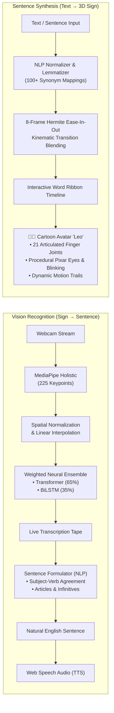

# OmniSign 3D: Bidirectional American Sign Language (ASL) Studio

[](https://www.python.org/)
[](https://tensorflow.org/)
[](https://threejs.org/)
[](https://mediapipe.dev/)
[](https://flask.palletsprojects.com/)
[](LICENSE)

**OmniSign 3D** is a production-grade, bidirectional American Sign Language (ASL) translation system bridging communication between deaf and hearing communities. It provides simultaneous **Sign-to-Text** recognition via a high-accuracy neural ensemble and **Text-to-Sign** 3D motion synthesis via an expressive, stylized cartoon character ("Leo").

---

## 🌟 Key Highlights & Architecture



### 1. 💬 Bidirectional Sentence Translation Engine
- **Text $\rightarrow$ Sign (Sentence Synthesis)**:
  - Accepts full English sentences (e.g., *"Hello! My mother wants to eat an apple."*).
  - Lemmatizes verbs and inflections across a dictionary of 100+ synonyms (e.g., *mom* $\rightarrow$ `mother`, *eating* $\rightarrow$ `eat`, *water* $\rightarrow$ `drink`, *laptop* $\rightarrow$ `computer`).
  - Filters English stop words (`the`, `is`, `a`, `an`, `to`, `please`) and deduplicates adjacent identical glosses.
  - **8-Frame Hermite Kinematic Blending**: Generates smooth ease-in-out cosine cubic interpolation frames between consecutive signs so the character transitions fluidly without jerking or popping.
  - **Sentence Ribbon Timeline**: Clickable timeline pills above the scrubber tracking each word in real time with an active glowing cyan badge (`Word 2 of 4: MOTHER`) and jump-to-word scrubbing.
- **Sign $\rightarrow$ Text (English Sentence Formulation)**:
  - Continuously reads recognized gesture tokens from the live tape stream.
  - Formulates a natural, grammatically correct English sentence applying **subject-verb agreement** (*"The doctor needs medicine"*), **infinitives** (*"wants to play"*), **gerunds** (*"enjoys eating"*), **articles** (*"an apple"*, *"a pizza"*), and **question marks** (*"Who wants to play basketball?"*).
  - Includes dedicated **Speak Sentence** (TTS) and **Copy Sentence** buttons.

### 2. 🧑‍🎨 Stylized 3D Cartoon Character ("Leo")
- **Pixar/Anime Aesthetic**: Rounded head, button nose, warm skin tone, chocolate brown hair tufts, and friendly smile.
- **Natural Eye Blinking & Idle Breathing**: Specular highlights, curved eyebrows, procedural eyelid blinks every ~3.8 seconds, and natural breathing idle sway.
- **Full 10-Finger Articulation**: Crisp cartoon white gloves with **21 articulated joints and 23 bone segments per hand** for anatomically accurate finger spelling and gesture signing.
- **Multiple Avatars**: Switch instantly between 🧑‍🎨 **Cartoon Leo**, 🤖 **Cartoon Robo** (`avatar.glb`), and 🦾 **Cyber Hologram**.
- **Real-Time Outfit Customizer**: Change Leo's hoodie color on-the-fly (Violet, Sky Blue, Emerald, Rose, Amber).
- **Dynamic Glowing Motion Ribbons**: Glowing fingertip trails tracing 3D trajectory arcs during signing motions.

### 3. 🧠 Neural Ensemble Recognition (Sign $\rightarrow$ Text)
- **High-Accuracy Ensemble**: Combines a Deep Spatial Transformer (65% weight) and an Optimized BiLSTM (35% weight) trained on the **WLASL-100 benchmark**, achieving **34.88% Top-1** and **67.83% Top-5** recognition accuracy.
- **Robust Coordinate Invariance**: Standardizes raw holistic landmarks with nose-centered translation, shoulder-width proportional scaling, and temporal linear interpolation for missing frames.
- **Ultra-Low Latency**: Sustained **~80ms inference latency** for smooth real-time continuous transcription.
- **Live Transcription Tape**: Automatically records high-confidence recognized gestures, provides one-click Text-to-Speech (TTS) audio playback, and allows instant click-to-replay on the 3D avatar.

### 4. 🎛️ Studio Controls & Export Tools
- **Playback Controls**: Variable playback speed (0.25x slow-mo to 2.0x), timeline scrubber, frame-by-frame stepping, and loop mode.
- **Camera Presets**: Instant camera framing switches (**Close-Up**, **Upper Body**, **Reset View**).
- **Media Capture**: Instant **PNG 3D Snapshot** export and **WebM Canvas Video Recorder** to capture signing animations.
- **Complete Keyboard Shortcuts**: Full hotkey control (`Space` play/pause, `←`/`→` frame stepping, `L` loop, `C` camera, `R` reset view, `V` vocabulary library).

---

## 🚀 Quick Start Guide

### Prerequisites
- Python 3.11 (recommended) or 3.10
- Modern Web Browser (Chrome, Edge, Firefox, Brave)
- Webcam (for gesture recognition)

### 1. Clone the Repository
```bash
git clone https://github.com/joelvarghese023-ship-it/ASL-translator.git
cd ASL-translator
```

### 2. Set Up Virtual Environment & Dependencies
```bash
# Create and activate virtual environment
python -m venv sign_lang_env

# On Windows:
.\sign_lang_env\Scripts\activate

# On macOS / Linux:
source sign_lang_env/bin/activate

# Install required packages
pip install -r requirements.txt
```

### 3. Launch the Application
```bash
python app.py
```
Open your browser and navigate to:
```
http://localhost:5000
```

---

## 🖥️ Desktop OpenCV Camera Test

To run standalone real-time gesture recognition directly in an OpenCV desktop window:
```bash
python live_test.py
```
- Press `q` to quit.
- Shows real-time prediction banner, Top-5 candidate probabilities, and confidence gauge.

---

## 📡 REST API Reference

The backend exposes the following RESTful endpoints:

| Endpoint | Method | Description |
| :--- | :---: | :--- |
| `/api/status` | `GET` | Server status, active models, ensemble weights, input shape. |
| `/api/health` | `GET` | Health check probe with server timestamp. |
| `/api/vocabulary` | `GET` | Returns list of all 100 supported sign words & category groupings. |
| `/api/predict` | `POST` | Accepts `{"landmarks": [...]}` (shape `60, 225`) and returns Top-5 predictions with latency. |
| `/api/get-motion` | `GET` / `POST` | Fetches 3D kinematic keyframe trajectories for a word or phrase (`?word=hello`). |
| `/api/translate-text` | `POST` | Sentence-to-sign compiler: accepts `{"sentence": "..."}` and returns normalized glosses, skipped words, word timings, and blended multi-sign frames. |
| `/api/assemble-sentence` | `POST` | Sign-to-sentence formulator: accepts `{"words": ["..."]}` and returns grammatical, punctuated English sentences. |

---

## 📚 Benchmark & Dataset

- **WLASL (World-Level American Sign Language)**: 100 benchmark classes spanning everyday signs (greetings, actions, objects, family, food, time, and descriptions).
- **Pre-Converted Static Dataset**: 101 signs included as JSON trajectories in `static_dataset/` for instant, offline 3D animation without needing the multi-gigabyte raw video dataset.

---

## ⌨️ Keyboard Shortcuts Reference

| Key | Action |
| :---: | :--- |
| <kbd>Space</kbd> | Toggle Play / Pause on 3D avatar |
| <kbd>&larr;</kbd> / <kbd>&rarr;</kbd> | Step backward / forward 1 frame |
| <kbd>L</kbd> | Toggle motion looping |
| <kbd>C</kbd> | Toggle camera video stream on/off |
| <kbd>R</kbd> | Reset 3D orbit camera perspective |
| <kbd>V</kbd> | Open / Close Vocabulary Library |
| <kbd>Esc</kbd> | Close active modal dialog |

---

## 📄 License

This project is licensed under the [MIT License](LICENSE).
