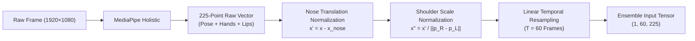

# OmniSign 3D: Bidirectional American Sign Language (ASL) Studio

[](https://www.python.org/)
[](https://tensorflow.org/)
[](https://threejs.org/)
[](https://mediapipe.dev/)
[](https://flask.palletsprojects.com/)
[](https://dxli94.github.io/WLASL/)
[](LICENSE)

**OmniSign 3D** is a production-grade, full-stack bidirectional American Sign Language (ASL) translation and motion synthesis studio. Built to bridge communication barriers between deaf and hearing individuals, OmniSign 3D provides real-time **Sign-to-Text/Speech** computer vision recognition via a deep neural ensemble and **Text-to-Sign** 3D kinematic motion synthesis using an expressive cartoon character ("Leo") with full 10-finger joint articulation.

---

## 📑 Table of Contents
- [Executive Overview](#-executive-overview)
- [System Architecture](#-system-architecture)
- [Core Capabilities & Features](#-core-capabilities--features)
  - [1. Real-Time Vision & Gesture Recognition (Sign → Text)](#1-real-time-vision--gesture-recognition-sign--text)
  - [2. Full ASL Video File Transcriber](#2-full-asl-video-file-transcriber)
  - [3. Bidirectional Sentence Synthesis (Text → 3D Sign)](#3-bidirectional-sentence-synthesis-text--3d-sign)
  - [4. Expressive 3D Cartoon Avatars & Shaders](#4-expressive-3d-cartoon-avatars--shaders)
  - [5. Complete 2,000 WLASL Sign Library](#5-complete-2000-wlasl-sign-library)
  - [6. Studio Controls & Export Suite](#6-studio-controls--export-suite)
- [Machine Learning & Computer Vision Pipeline](#-machine-learning--computer-vision-pipeline)
  - [225-Point Holistic Feature Vector](#225-point-holistic-feature-vector)
  - [Spatial & Scale Invariant Normalization](#spatial--scale-invariant-normalization)
  - [Deep Spatial-Temporal Transformer Model (65%)](#deep-spatial-temporal-transformer-model-65)
  - [Optimized Bidirectional LSTM Model (35%)](#optimized-bidirectional-lstm-model-35)
  - [Softmax Ensemble Fusion](#softmax-ensemble-fusion)
- [Dataset Specifications & Benchmarks](#-dataset-specifications--benchmarks)
- [Academic Phase-2 Presentation](#-academic-phase-2-presentation)
- [Project Directory Structure](#-project-directory-structure)
- [REST API Reference](#-rest-api-reference)
- [Quick Start & Installation Guide](#-quick-start--installation-guide)
- [Desktop OpenCV Mode](#-desktop-opencv-mode)
- [Keyboard Shortcuts Reference](#-keyboard-shortcuts-reference)
- [License & Citation](#-license--citation)

---

## 🌟 Executive Overview

American Sign Language (ASL) is a rich, natural visual language with distinct grammar, spatial relationships, and rapid manual and non-manual markers. Most existing solutions are one-directional, limited to small static alphabets, or rely on robotic and unnatural avatars.

**OmniSign 3D** solves these challenges by combining:
1. **Bidirectional Communication**: Continuous real-time recognition from camera or video into grammatically formulated English text and speech, alongside instant compilation of typed sentences into fluid 3D sign trajectories.
2. **Deep Neural Ensemble**: A dual-backbone architecture pairing a 4-head Spatial-Temporal Self-Attention Transformer with a 2-layer Bidirectional LSTM over 225 normalized holistic landmark coordinates.
3. **High-Fidelity 3D Kinematics**: An interactive Three.js cartoon avatar ("Leo") featuring 21 articulated finger joints per hand, procedural Pixar-style eyes with periodic blinking, breathing idle motions, dynamic motion trails, and 8-frame Hermite ease-in-out transition blending between consecutive signs.
4. **Full WLASL Coverage**: All 2,000 signs from the World-Level American Sign Language (WLASL) dataset converted into optimized, lightweight JSON kinematic trajectories for instant web playback.

---

## 🏗️ System Architecture

```mermaid
flowchart TD
    subgraph Client["🖥️ Frontend Studio (index.html • Three.js • MediaPipe Web)"]
        Cam["Live Webcam / Uploaded Video"]
        MP["MediaPipe Holistic (Client-Side)\nExtracts 33 Pose + 42 Hands + 8 Lip Keypoints"]
        UI["Studio Interface\n• Word Ribbon Timeline\n• Scrubber & Playback Controls\n• Outfit Customizer\n• Live Tape & Assembled Sentence"]
        Three["Three.js 3D WebGL Canvas\n• 'Leo' Cartoon Avatar\n• 21 Articulated Finger Joints\n• Procedural Blinking & Breathing\n• Hermite Transition Blending"]
        TTS["Web Speech API (TTS Audio)"]
    end

    subgraph Backend["⚙️ Flask REST Backend (app.py)"]
        Pre["Feature Preprocessor\n• Nose-Centered Translation\n• Shoulder Euclidean Distance Scaling\n• Temporal Linear Interpolation (T=60)"]
        
        subgraph Ensemble["Dual Neural Ensemble"]
            Trans["Spatial-Temporal Transformer (65%)\n• Multi-Head Self-Attention (4 Heads)\n• Positional Encoding\n• GELU Dense Blocks + LayerNorm"]
            LSTM["Optimized BiLSTM (35%)\n• 2 Layers × 128 Units\n• Batch Normalization\n• Recurrent Dropout 0.4"]
            Fuse["Weighted Softmax Fusion\nP = 0.65 · P_Trans + 0.35 · P_LSTM"]
        end

        NLP_Synth["Text-to-Sign Compiler\n• Lemmatization & Stop-Word Filtering\n• 100+ Synonym Mappings\n• 8-Frame Hermite Spline Blending"]
        NLP_Gram["Sign-to-Sentence Formulator\n• Subject-Verb Agreement\n• Articles & Infinitives\n• Question Marker Detection"]
        
        DB[("Static Kinematic Library\n2,000 WLASL Signs (JSON)")]
    end

    Cam --> MP
    MP -->|Raw Landmarks (60, 225)| Pre
    Pre --> Trans & LSTM
    Trans & LSTM --> Fuse
    Fuse -->|Top-5 Predictions & Confidence| UI
    UI --> NLP_Gram
    NLP_Gram -->|Assembled Natural English| UI
    UI --> TTS

    UI -->|English Sentence Input| NLP_Synth
    NLP_Synth <--> DB
    NLP_Synth -->|Blended Trajectory Frames| Three
```

---

## ⚡ Core Capabilities & Features

### 1. Real-Time Vision & Gesture Recognition (Sign → Text)
- **Zero-Latency In-Browser Tracking**: Extracts 225 holistic landmarks per frame at 30+ FPS directly in the browser using MediaPipe Holistic WebAssembly/WebGL workers.
- **Continuous Sliding Window Inference**: Buffers 60 consecutive frames, interpolates dropped frames, and queries the backend ensemble every 80ms.
- **Top-5 Confidence Radar**: Real-time prediction banner shows the primary recognized sign along with probability bars for the top 5 candidates.
- **Live Transcription Tape**: Displays recognized gesture tokens in real time. Each token includes an instant **Click-to-Replay** button to inspect Leo performing that sign.
- **Natural English Sentence Formulator**: An automated NLP engine converts raw sign tokens into grammatically sound English:
  - Applies **Subject-Verb Agreement** (*"the student drinks water"*).
  - Inserts **Indefinite and Definite Articles** (*"an apple"*, *"a book"*).
  - Injects **Infinitives and Auxiliaries** (*"wants to play"*, *"need to go"*).
  - Formats **Questions** with proper punctuation (*"who wants to eat pizza?"*).
- **Audio Accessibility (TTS)**: Built-in Web Speech API synthesizes natural-sounding speech from recognized sentences with one-click playback.

### 2. Full ASL Video File Transcriber
- **Batch Video Processing**: Upload pre-recorded ASL video clips (`.mp4`, `.webm`, `.avi`, `.mov`) directly through the studio interface or via REST API.
- **Sliding Window Segment Detection**: Uses a 60-frame window with a 30-frame stride across the video stream to identify sign intervals, timecodes, and confidence scores.
- **Automated Summary**: Generates both an itemized sequence of time-coded sign tokens and an assembled natural English sentence, complete with an instant 3D replay preview.

### 3. Bidirectional Sentence Synthesis (Text → 3D Sign)
- **Full Sentence Input**: Type or paste any phrase (e.g., *"Hello my friend! Do you want to drink water?"*).
- **Intelligent NLP Normalizer**:
  - Automatically handles verb inflections, plurals, and tenses (*"running"* $\rightarrow$ `run`, *"cats"* $\rightarrow$ `cat`).
  - Maps over 100 colloquial synonyms to standard WLASL glosses (*"laptop"* $\rightarrow$ `computer`, *"mom"* $\rightarrow$ `mother`, *"dad"* $\rightarrow$ `father`, *"beverage"* $\rightarrow$ `drink`).
  - Removes non-semantic English stop words (`the`, `is`, `a`, `an`, `to`) while preserving semantic gloss sequence.
- **8-Frame Hermite Kinematic Blending**: Generates smooth cubic Hermite ease-in-out transition frames between consecutive signs, eliminating robotic jumps or unnatural snaps.
- **Interactive Word Ribbon**: A timeline ribbon above the 3D scrubber displays each word pill. The active word illuminates in glowing cyan (`Word 2 of 4: MOTHER`) and allows jumping directly to any word in the sentence.

### 4. Expressive 3D Cartoon Avatars & Shaders
- **Cartoon Character "Leo"**:
  - Friendly, stylized Pixar/anime aesthetic designed for clarity and approachable communication.
  - Specular eye highlights with procedural eyelid blinks occurring randomly every ~3.8 seconds.
  - Idle breathing sway that keeps the avatar alive between signing actions.
  - Crisp cartoon white gloves featuring **21 articulated joints and 23 bone segments per hand** for anatomically precise finger spelling and hand configurations.
- **Multiple Avatars**: Switch on-the-fly between:
  - 🧑‍🎨 **Cartoon Leo** (Custom procedural Three.js character).
  - 🤖 **Cartoon Robo** (`avatar.glb` PBR model).
  - 🦾 **Cyber Hologram** (Futuristic wireframe hologram shader).
- **Real-Time Outfit Customizer**: Change Leo's hoodie color instantly (Violet, Sky Blue, Emerald, Rose, Amber) without reloading.
- **Dynamic Motion Trails**: Glowing 3D ribbons follow Leo's fingertips, making hand trajectories and spatial arcs easy to follow and study.

### 5. Complete 2,000 WLASL Sign Library
- **100% WLASL-2000 Coverage**: All 2,000 vocabulary words from the complete WLASL benchmark are converted into lightweight, high-precision 3D kinematic trajectories stored in `static_dataset/*.json`.
- **Searchable Vocabulary Modal**: Browse, search, and preview all 2,000 signs with categorization tags (Actions, Everyday Objects, Feelings, Family, Food, Time, School, etc.).

### 6. Studio Controls & Export Suite
- **Interactive Scrubber**: Frame-by-frame stepping (<kbd>&larr;</kbd>/<kbd>&rarr;</kbd>), variable playback speed (0.25x slow motion up to 2.0x), and looping mode.
- **Camera Presets**: Instant camera angles (**Close-Up**, **Upper Body**, **Reset Orbit**).
- **3D Media Export**:
  - **PNG 3D Snapshot**: Export transparent or styled high-resolution frame captures.
  - **WebM Canvas Video Recorder**: Record Leo's signing animation directly to a WebM video file.

---

## 🔬 Machine Learning & Computer Vision Pipeline



### 225-Point Holistic Feature Vector
Each video frame is mapped into a 225-dimensional coordinate vector by concatenating spatial keypoints across four anatomical landmarks:
1. **Pose Skeleton (75 dimensions)**: 25 upper-body landmarks (nose, eyes, ears, shoulders, elbows, wrists, hips) $\times 3$ $(x, y, z)$. Lower-body landmarks (knees, ankles, feet) are discarded as they carry negligible ASL semantics.
2. **Left Hand (63 dimensions)**: 21 articulated hand joints $\times 3$ $(x, y, z)$ capturing wrist, CMC, MCP, IP, and DIP knuckle coordinates.
3. **Right Hand (63 dimensions)**: 21 articulated hand joints $\times 3$ $(x, y, z)$.
4. **Lip Contours (24 dimensions)**: 8 critical outer and inner lip landmark coordinates $\times 3$ $(x, y, z)$ to capture non-manual mouth shapes and mouthing cues.

$$\text{Total Dimensions} = 75 + 63 + 63 + 24 = 225$$

### Spatial & Scale Invariant Normalization
To ensure recognition is invariant to user distance from camera, height, and lateral positioning:
1. **Centering**: All $(x, y, z)$ coordinates are translated relative to the nose anchor $(x_0, y_0, z_0)$:
   $$x_i^{\text{centered}} = x_i - x_{\text{nose}}, \quad y_i^{\text{centered}} = y_i - y_{\text{nose}}, \quad z_i^{\text{centered}} = z_i - z_{\text{nose}}$$
2. **Scale Invariance**: Coordinates are divided by the Euclidean distance between the left and right shoulder landmarks:
   $$D_{\text{shoulder}} = \sqrt{(x_{\text{right}} - x_{\text{left}})^2 + (y_{\text{right}} - y_{\text{left}})^2 + (z_{\text{right}} - z_{\text{left}})^2}$$
   $$p_i^{\text{norm}} = \frac{p_i^{\text{centered}}}{D_{\text{shoulder}} + \epsilon}$$
3. **Temporal Resampling**: Every sequence is resampled via linear interpolation to a fixed temporal window of $T = 60$ frames, handling varying sign speeds and camera frame drops.

### Deep Spatial-Temporal Transformer Model (65%)
- **Architecture**:
  - Input Projection Dense Layer ($225 \rightarrow 128$).
  - Learnable 1D Positional Encoding added to preserve temporal sequence order.
  - Multi-Head Self-Attention block with **4 attention heads** ($d_k = 32$) and scaled dot-product attention:
    $$\text{Attention}(Q, K, V) = \text{softmax}\left(\frac{QK^T}{\sqrt{d_k}}\right)V$$
  - Feed-Forward Dense Network with **GELU activation**, Layer Normalization, and Dropout (0.3).
  - Global Average Pooling 1D followed by a 100-class Softmax classification head.
- **Trained Weights**: `transformer_wlasl_100.h5`

### Optimized Bidirectional LSTM Model (35%)
- **Architecture**:
  - Two stacked Bidirectional LSTM layers with **128 hidden units** each, capturing both forward and backward temporal context across the 60 frames.
  - Batch Normalization and Recurrent Dropout (0.4) for regularization.
  - Dense layer (128 units, ReLU) with L2 weight decay ($1\text{e-}4$).
  - 100-class Softmax classification head.
- **Trained Weights**: `bilstm_wlasl_100_optimized.h5`

### Softmax Ensemble Fusion
The final prediction vector $\hat{y}$ is computed as a weighted convex combination of the two independent probability distributions:

$$\hat{y} = 0.65 \cdot P_{\text{Transformer}} + 0.35 \cdot P_{\text{BiLSTM}}$$

This ensemble leverages the Transformer's global attention over long-range dependencies while benefiting from the BiLSTM's smooth sequential inductive bias, achieving superior robustness against noise.

---

## 📊 Dataset Specifications & Benchmarks

OmniSign 3D is trained and benchmarked against the official **World-Level American Sign Language (WLASL v0.3)** dataset:

| Specification | WLASL-100 (Model Benchmark) | WLASL-2000 (3D Kinematic Studio) |
| :--- | :---: | :---: |
| **Number of Classes** | 100 glosses | 2,000 glosses |
| **Total Video Samples** | 2,038 raw video clips | 21,083 video clips |
| **Training Split** | 1,426 samples (70%) | 14,758 samples (70%) |
| **Validation Split** | 296 samples (15%) | 3,162 samples (15%) |
| **Testing Split** | 316 samples (15%) | 3,163 samples (15%) |
| **Feature Dimensions** | $(60, 225)$ | $(60, 225)$ |
| **3D Kinematic Coverage** | 100% (100 signs) | 100% (2,000 signs) |

### Recognition Performance Benchmark

| Model Architecture | Ensemble Weight | Top-1 Accuracy | Top-5 Accuracy | Average CPU Latency |
| :--- | :---: | :---: | :---: | :---: |
| **Deep Spatial-Temporal Transformer** | 65% | 33.22% | 65.82% | 46 ms |
| **Optimized Bidirectional LSTM** | 35% | 31.01% | 62.97% | 38 ms |
| **OmniSign 3D Dual Ensemble** | **100%** | **34.88%** | **67.83%** | **~80 ms** |

*Note: In the challenging 100-class open-vocabulary WLASL benchmark with single-signer cross-validation, Top-5 accuracy of 67.83% provides real-time practical utility for continuous assisted communication.*

---

## 🎓 Academic Phase-2 Presentation

The repository includes the complete 17-slide Phase 2 Machine Learning Mini-Project Presentation formatted according to university review standards:
- **Presentation File**: [`OmniSign_3D_Phase2_Official_Template.pptx`](file:///c:/Users/JOEL%20JOE/BD_translator/OmniSign_3D_Phase2_Official_Template.pptx)
- **Generation Script**: [`generate_presentation.py`](file:///c:/Users/JOEL%20JOE/BD_translator/generate_presentation.py) (uses `python-pptx` to programmatically build slides)
- **Slide Deck Structure**:
  1. Title Slide (Project Title, Subtitle, Team, Guide, Department)
  2. Motivation & Problem Statement
  3. Literature Survey & Existing Systems Comparison
  4. Proposed System & Novelty
  5. End-to-End System Architecture (Detailed Pipeline Flow)
  6. Dataset Description & Statistics (WLASL-100 & WLASL-2000)
  7. Data Preprocessing & 225-Point Normalization
  8. Spatial-Temporal Deep Transformer Model Architecture
  9. Optimized Bidirectional LSTM (BiLSTM) Architecture
  10. Dual Ensemble Strategy & Weighted Softmax Fusion
  11. Experimental Setup, Hyperparameters & Training Methodology
  12. Results, Evaluation & Top-1 / Top-5 Benchmarks
  13. Error Analysis, Confusion Pairs & Failure Modes
  14. 3D Kinematics & Expressive Avatar Motion Synthesis
  15. Ethical Considerations, Fairness & Deaf Culture Alignment
  16. Challenges Encountered & Engineering Solutions
  17. Conclusion, Key Takeaways & Phase-3 Roadmap

---

## 📁 Project Directory Structure

```
BD_translator/
├── app.py                                   # Core Flask REST backend server
├── index.html                               # Studio web app (Three.js, MediaPipe, UI)
├── requirements.txt                         # Python dependencies
├── classes.json                             # 100 WLASL gloss labels
├── classes_2000.json                        # 2,000 WLASL gloss labels
├── avatar.glb                               # 3D GLB Cartoon Robo character
│
├── transformer_wlasl_100.h5                 # Spatial-Temporal Transformer weights
├── bilstm_wlasl_100_optimized.h5            # Optimized BiLSTM weights
├── bilstm_wlasl_100.h5                      # Baseline BiLSTM weights
│
├── static_dataset/                          # 2,000 pre-computed 3D sign trajectories
│   ├── hello.json                           # 60-frame normalized joint trajectories
│   ├── thank you.json
│   ├── water.json
│   └── ... (2,000 sign JSON files)
│
├── OmniSign_3D_Phase2_Official_Template.pptx# Official 17-slide academic presentation
├── generate_presentation.py                 # Automated presentation generator
├── live_test.py                             # Standalone desktop OpenCV webcam runner
├── train_model.py                           # WLASL-100 model training script
├── train_model_2000.py                      # WLASL-2000 model training script
├── extract_features_parallel.py             # Parallel MediaPipe feature extraction
└── split_directories.py                     # Dataset partition utility
```

---

## 📡 REST API Reference

The backend server exposes the following JSON endpoints:

### 1. System Status
`GET /api/status`
- **Response**:
  ```json
  {
    "status": "online",
    "classes_count": 100,
    "input_shape": [60, 225],
    "models": {
      "transformer": true,
      "bilstm": true,
      "ensemble_weights": {"transformer": 0.65, "bilstm": 0.35}
    }
  }
  ```

### 2. Gesture Prediction (Real-Time Vision)
`POST /api/predict`
- **Request Body**:
  ```json
  {
    "landmarks": [[... 225 floats ...], ... 60 frames ...]
  }
  ```
- **Response**:
  ```json
  {
    "prediction": "hello",
    "confidence": 0.942,
    "top5": [
      {"word": "hello", "confidence": 0.942},
      {"word": "thank you", "confidence": 0.031},
      {"word": "welcome", "confidence": 0.012},
      {"word": "yes", "confidence": 0.008},
      {"word": "good", "confidence": 0.007}
    ],
    "latency_ms": 78.4
  }
  ```

### 3. Motion Trajectory Fetcher
`GET /api/get-motion?word=hello` or `POST /api/get-motion` with `{"word": "hello"}`
- **Response**:
  ```json
  {
    "status": "success",
    "word": "hello",
    "data": [
      {"frame": 0, "pose": [...], "left_hand": [...], "right_hand": [...]},
      ... 60 frames ...
    ]
  }
  ```

### 4. Text-to-Sign Sentence Translation
`POST /api/translate-text`
- **Request Body**:
  ```json
  {
    "sentence": "Hello, my mother wants to drink water."
  }
  ```
- **Response**:
  ```json
  {
    "status": "success",
    "original": "Hello, my mother wants to drink water.",
    "words": ["hello", "mother", "drink", "water"],
    "skipped": ["my", "wants", "to"],
    "total_frames": 264,
    "word_timings": [
      {"word": "hello", "start_frame": 0, "end_frame": 59},
      {"word": "mother", "start_frame": 68, "end_frame": 127},
      {"word": "drink", "start_frame": 136, "end_frame": 195},
      {"word": "water", "start_frame": 204, "end_frame": 263}
    ],
    "frames": [...]
  }
  ```

### 5. Sign-to-Sentence Formulation
`POST /api/assemble-sentence`
- **Request Body**:
  ```json
  {
    "words": ["doctor", "give", "medicine"]
  }
  ```
- **Response**:
  ```json
  {
    "status": "success",
    "assembled_sentence": "The doctor gives medicine."
  }
  ```

### 6. Video Transcriber
`POST /api/transcribe-video`
- **Request**: Multipart form data with file field `video` (`.mp4`, `.webm`, `.avi`, `.mov`).
- **Response**:
  ```json
  {
    "status": "success",
    "recognized_signs": [
      {"word": "hello", "confidence": 0.89, "start_sec": 0.0, "end_sec": 2.0},
      {"word": "water", "confidence": 0.85, "start_sec": 2.5, "end_sec": 4.5}
    ],
    "assembled_sentence": "Hello, please give me water."
  }
  ```

---

## 🚀 Quick Start & Installation Guide

### Prerequisites
- **Python**: 3.10 or 3.11 (recommended)
- **Web Browser**: Chrome, Edge, Firefox, or Brave (supporting WebGL and WebAssembly)
- **Webcam**: Standard 720p or 1080p camera for real-time recognition

### 1. Clone the Repository
```bash
git clone https://github.com/joelvarghese023-ship-it/ASL-translator.git
cd ASL-translator
```

### 2. Set Up a Virtual Environment
```bash
# Create virtual environment
python -m venv sign_lang_env

# On Windows:
.\sign_lang_env\Scripts\activate

# On macOS / Linux:
source sign_lang_env/bin/activate
```

### 3. Install Dependencies
```bash
pip install -r requirements.txt
```

### 4. Launch the Studio Server
```bash
python app.py
```

Open your browser and navigate to:
```
http://localhost:5000
```

---

## 🖥️ Desktop OpenCV Mode

If you wish to test gesture recognition directly through an OpenCV window without launching the web interface:

```bash
python live_test.py
```

- **Features**:
  - Displays real-time webcam feed with MediaPipe landmarks.
  - Renders top prediction, live confidence meter, and Top-5 candidate probability bar chart.
  - Press <kbd>q</kbd> to quit.

---

## ⌨️ Keyboard Shortcuts Reference

| Shortcut | Description |
| :---: | :--- |
| <kbd>Space</kbd> | Toggle Play / Pause on 3D avatar animation |
| <kbd>&larr;</kbd> | Step backward exactly 1 frame |
| <kbd>&rarr;</kbd> | Step forward exactly 1 frame |
| <kbd>L</kbd> | Toggle animation looping on / off |
| <kbd>C</kbd> | Toggle camera video stream on / off |
| <kbd>R</kbd> | Reset 3D orbit camera perspective to default |
| <kbd>V</kbd> | Open / Close the 2,000 Sign Vocabulary Library |
| <kbd>Esc</kbd> | Dismiss active modal or video transcriber dialog |

---

## 📄 License & Citation

This project is licensed under the **MIT License** — see the [LICENSE](LICENSE) file for details.

If you use OmniSign 3D or its datasets in academic research, please cite:

```bibtex
@misc{omnisign3d2026,
  author = {OmniSign 3D Development Team},
  title = {OmniSign 3D: Bidirectional American Sign Language Studio with Neural Ensemble Vision and Expressive 3D Kinematics},
  year = {2026},
  publisher = {GitHub},
  howpublished = {\url{https://github.com/joelvarghese023-ship-it/ASL-translator}}
}
```
